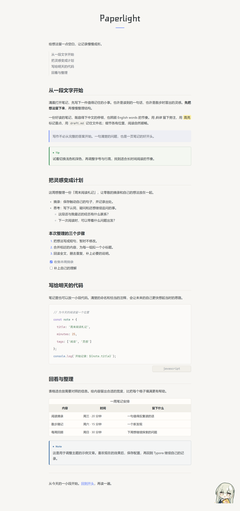
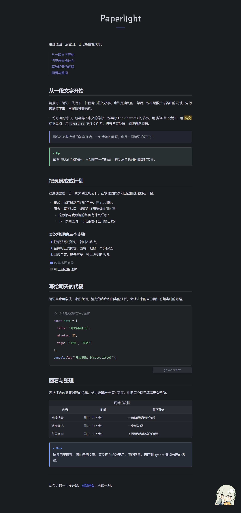
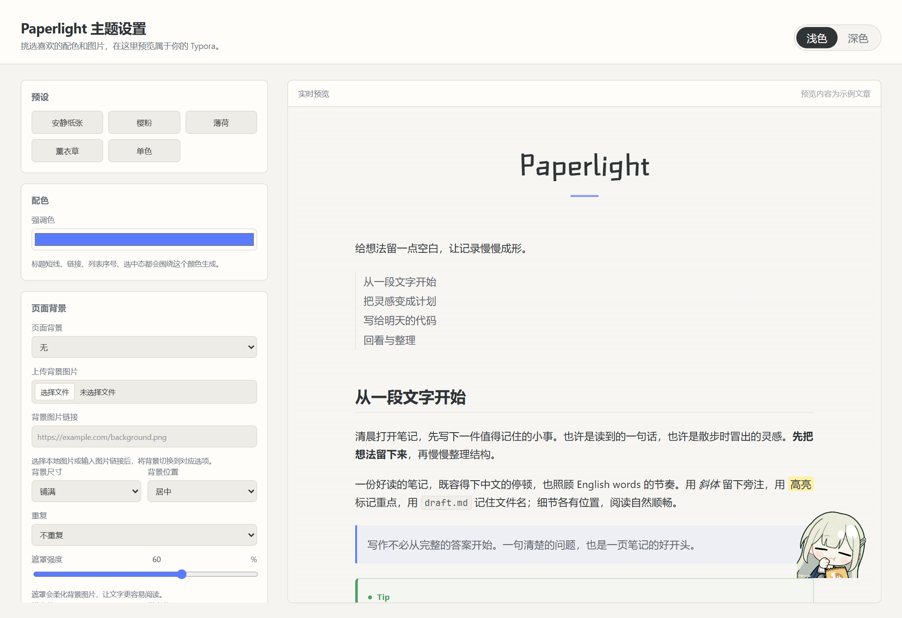

<h1 align='center'>Paperlight Theme For Typora</h1>

<a href="https://xtr-hub.github.io/paperlight-typora-theme/"><strong>在线配置 · 实时预览</strong></a> · <a href="#安装主题">安装主题</a>

  
  
  
  

> [!note]
> **关于本仓库**
>
> Paperlight 由 [caolib/typora-onelight-theme](https://github.com/caolib/typora-onelight-theme) 演化而来，感谢原作者 @caolib 创作了原主题。本仓库直接 fork 自 [Typora 官方主题仓库](https://github.com/typora/theme.typora.io)。
>
> 本项目由社区独立维护，与 Typora 官方及原主题作者没有官方关联，也未获得授权或移交。

	简体中文 |
	<a href="https://zdoc.app/de/xtr-hub/paperlight-typora-theme">Deutsch</a> |
	<a href="https://zdoc.app/en/xtr-hub/paperlight-typora-theme">English</a> |
	<a href="https://zdoc.app/es/xtr-hub/paperlight-typora-theme">Español</a> |
	<a href="https://zdoc.app/fr/xtr-hub/paperlight-typora-theme">français</a> |
	<a href="https://zdoc.app/ja/xtr-hub/paperlight-typora-theme">日本語</a> |
	<a href="https://zdoc.app/ko/xtr-hub/paperlight-typora-theme">한국어</a> |
	<a href="https://zdoc.app/pt/xtr-hub/paperlight-typora-theme">Português</a> |
	<a href="https://zdoc.app/ru/xtr-hub/paperlight-typora-theme">Русский</a>

  
  
  

## 推荐：在线配置

**[打开 Paperlight 在线配置页](https://xtr-hub.github.io/paperlight-typora-theme/)**，直观调整配色、排版、背景和表情包，并实时预览浅色与深色效果。

1. 首次使用时，先按下方的[安装主题](#安装主题)步骤将 Paperlight 安装到 Typora。
2. 在在线配置页调整设置，选择 Typora 的主题文件夹，点击 **保存到主题文件夹**。浏览器不支持直接写入时，可下载 CSS 后手动放入主题文件夹。
3. 重启 Typora 或切换一次主题，应用设置。配置页生成的是个人配置文件，不会替你安装主题本体。

## 主题预览

Paperlight 是一款适用于 Typora 的浅色与深色主题，提供代码高亮、表格、引用和提示框样式。可以通过可视化设置页调整配色、字体、背景和表情包。

以下截图为浏览器中的示例预览，Typora 的实际界面可能略有不同。

**浅色主题**

**深色主题**

## 安装主题

1. 下载 [paperlight 分支源码 ZIP](https://github.com/xtr-hub/paperlight-typora-theme/archive/refs/heads/paperlight.zip) 并解压。
2. 在 Typora 中打开 **偏好设置 → 外观 → 打开主题文件夹**。
3. 将解压后目录内的 <code>paperlight.css</code>、<code>paperlight-dark.css</code> 和整个 <code>paperlight/</code> 文件夹复制到打开的主题文件夹中。不要把它们放在额外一层项目文件夹里。
4. 重启 Typora，在 **主题** 菜单选择 **Paperlight** 或 **Paperlight Dark**。

> [!NOTE]
> 原 OneLight 仓库中的历史 Release 早于 Paperlight，不能保证兼容新版设置页。请安装上述 <code>paperlight</code> 分支的当前版本。

也可以克隆源码，再按第 2～4 步复制主题文件：

~~~bash
git clone --single-branch --branch paperlight https://github.com/xtr-hub/paperlight-typora-theme.git
~~~

安装后的目录结构：

~~~text
themes/
├── paperlight.css                  # 浅色主题入口
├── paperlight-dark.css             # 深色主题入口
├── paperlight.user.css             # 浅色个人配置，可选
├── paperlight-dark.user.css        # 深色个人配置，可选
└── paperlight/
    ├── fonts/                    # 随主题提供的字体
    ├── img/                      # 随主题提供的图片
    └── style/
        ├── theme.css             # 浅色主题样式
        └── theme-dark.css        # 深色主题变量覆盖
~~~

更新主题时，重新复制两个主题入口和 <code>paperlight/</code> 资源目录；保留两个 <code>.user.css</code> 文件即可保留个人配置。

## 配置选项与保存

打开 **[Paperlight 主题设置页](https://xtr-hub.github.io/paperlight-typora-theme/)**，调整后可以实时预览浅色和深色主题：

- 选择强调色、字体、字号、行高、内容宽度、圆角和标题装饰。
- 使用内置图片、本地图片或 HTTP(S) 链接自定义页面背景与表情包；可调整背景位置、平铺和遮罩，以及表情包的四角位置、边距、大小和透明度。
- 设置自动保存在当前浏览器中，也可以导出 JSON，之后重新导入。清除浏览器数据或更换浏览器前，请先导出配置。

设置完成后，选择 Typora 的主题文件夹并点击 **保存到主题文件夹**，然后重启 Typora 或切换一次主题。页面会写入 <code>paperlight.user.css</code> 和 <code>paperlight-dark.user.css</code> 中的配置块，保留文件中的其他自定义 CSS；不会安装或替换主题本体。刷新网页后需重新选择文件夹。

文件夹直接写入需要用户授权，以及支持 File System Access API 的浏览器；不支持时可下载或复制两个 CSS 文件，手动放入主题文件夹。已有同名文件时，请先合并或备份原文件，避免覆盖自己写的样式。

本地图片支持 PNG、JPEG、GIF、WebP、AVIF，单张不超过 8 MB，会嵌入导出的 CSS 和配置文件；图片链接则依赖网络和链接可用性。

## 从旧版 OneLight 迁移

旧版 <code>onelight.css</code> 和 <code>onelight-dark.css</code> 可继续作为兼容入口使用。要在 Paperlight 主题中沿用个人样式，请在主题文件夹中将已有的 <code>onelight.user.css</code> 和 <code>onelight-dark.user.css</code> 分别复制为 <code>paperlight.user.css</code> 和 <code>paperlight-dark.user.css</code>，并保留原文件作为备份；如果目标文件已存在，请先检查并合并内容。设置页也支持导入旧版导出的 JSON 配置。

## 手动添加样式

可以在主题目录中创建 <code>paperlight.user.css</code>（浅色）或 <code>paperlight-dark.user.css</code>（深色）来添加个人 CSS。Typora 会在对应主题之后加载这些文件；通常无需修改主题源码。设置页会为自动生成的区块添加标记，区块外的自定义样式不会被页面直接保存时覆盖。

## 本地运行与静态部署

在仓库根目录运行：

~~~bash
node tools/theme-configurator/serve.mjs
~~~

随后访问 <http://127.0.0.1:4173/tools/theme-configurator/>。要构建静态站点，运行：

~~~bash
node tools/theme-configurator/build.mjs
~~~

将生成的 <code>dist/</code> 用作静态网站发布目录，<code>dist/index.html</code> 为入口。运行时不需要后端；<code>dist/</code> 是构建产物，不提交到 Git。浏览器直接写入主题目录需要 HTTPS 或 localhost 和用户授权。

仓库提供 GitHub Pages 工作流。将仓库 **Settings → Pages → Build and deployment → Source** 设为 **GitHub Actions** 后，推送到 <code>paperlight</code> 分支会自动构建和部署。更多使用、部署和测试细节见 [设置页说明](tools/theme-configurator/README.md)。

## 其他

- [示例 Markdown 文档](docs/demo.md)
- [主题截图工具](tools/demo-shots/README.md)
- [反馈问题与建议](https://github.com/xtr-hub/paperlight-typora-theme/issues)

喜欢这个主题的话，欢迎给仓库点个 Star！
