<h1 align='center'>OneLight Theme For Typora</h1>

<p align="center">
  
  
  
  
</p>

> [!note]
> **关于本仓库**
>
> 本仓库是 [caolib/typora-onelight-theme](https://github.com/caolib/typora-onelight-theme) 的**非官方社区 fork**，与原仓库及原作者 @caolib 无关联，也未获得任何形式的授权或移交。在此感谢原作者创作了这套主题。
>
> 由于原仓库已停止更新，本仓库由使用者 [@xtr-hub](https://github.com/xtr-hub) 自发进行日常维护（修复问题、跟进 Typora 更新等），并在本仓库独立发布版本，仅供参考学习。

<p align="center">
	简体中文 |
	<a href="https://zdoc.app/de/xtr-hub/typora-onelight-theme">Deutsch</a> | 
	<a href="https://zdoc.app/en/xtr-hub/typora-onelight-theme">English</a> | 
	<a href="https://zdoc.app/es/xtr-hub/typora-onelight-theme">Español</a> | 
	<a href="https://zdoc.app/fr/xtr-hub/typora-onelight-theme">français</a> | 
	<a href="https://zdoc.app/ja/xtr-hub/typora-onelight-theme">日本語</a> | 
	<a href="https://zdoc.app/ko/xtr-hub/typora-onelight-theme">한국어</a> | 
	<a href="https://zdoc.app/pt/xtr-hub/typora-onelight-theme">Português</a> | 
	<a href="https://zdoc.app/ru/xtr-hub/typora-onelight-theme">Русский</a>
</p>


<p align="center">
  
  
  
</p>

## 1.概览

---

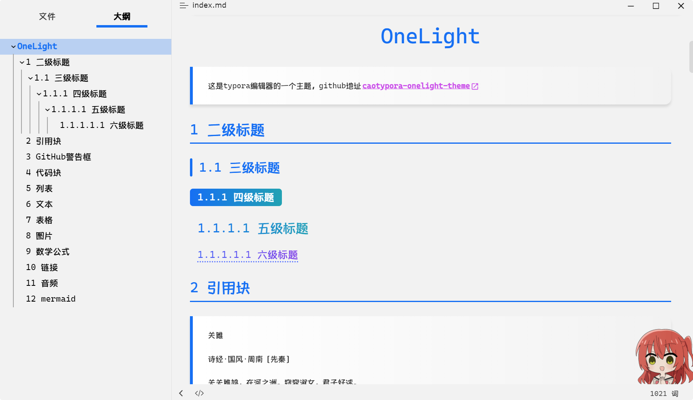

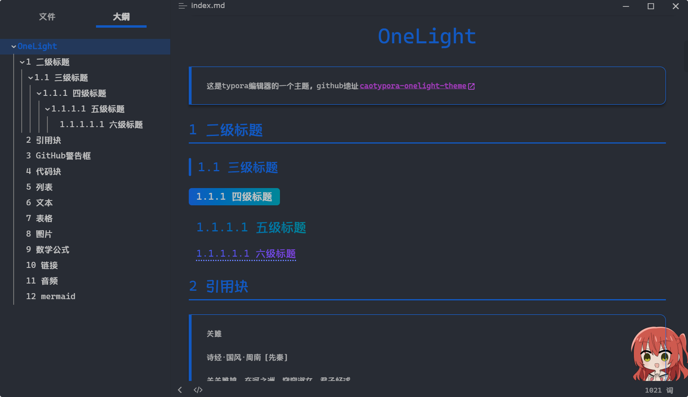

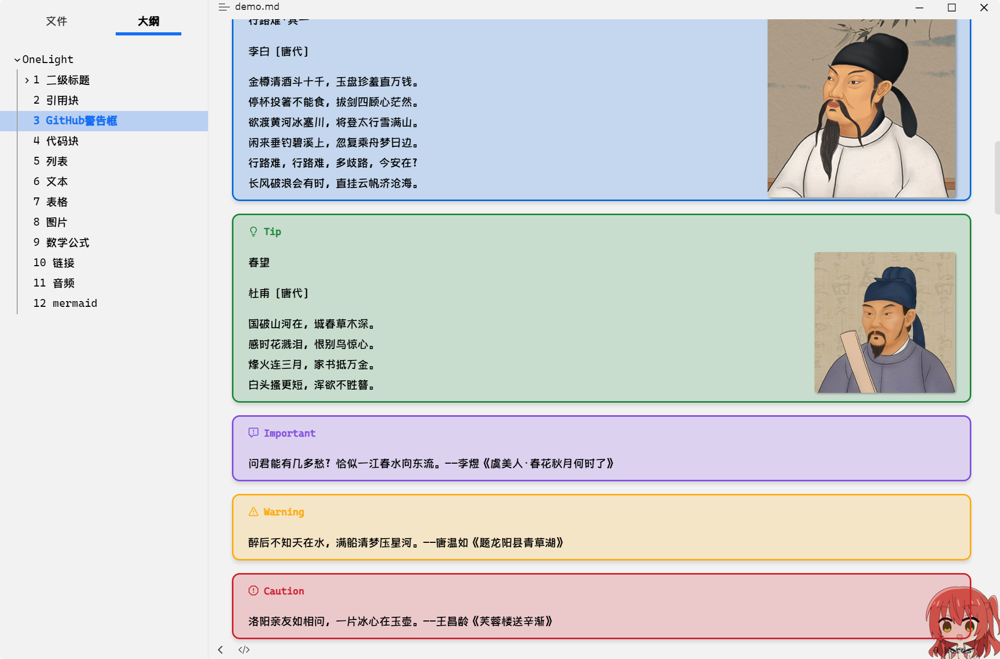

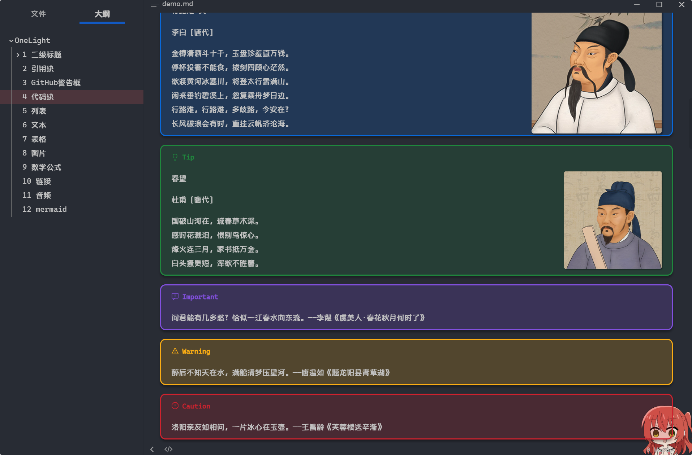

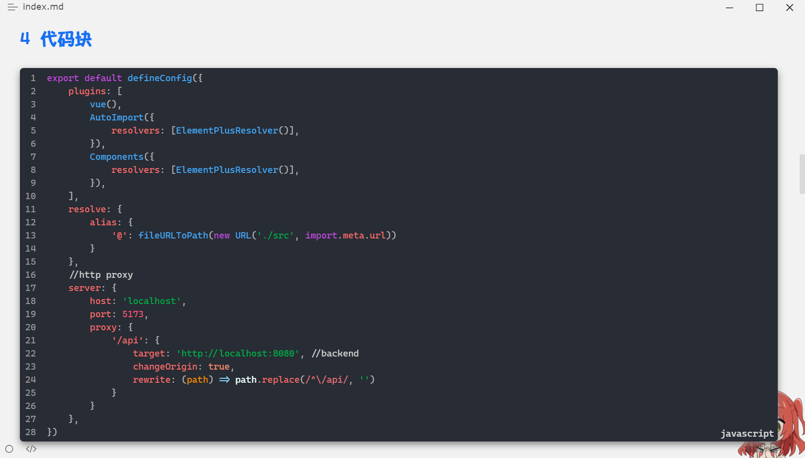

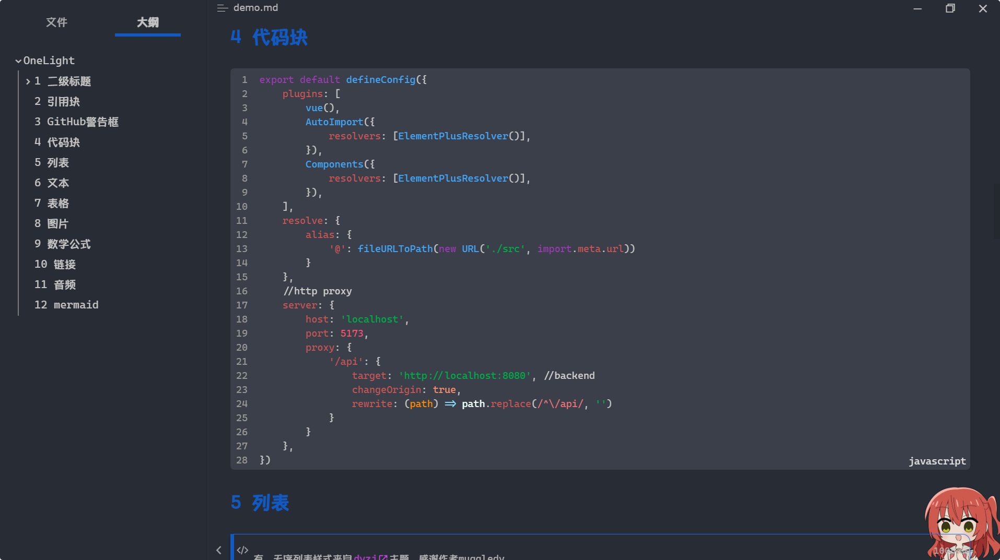

<details><summary><kbd>展开查看更多截图</summary></kbd>
  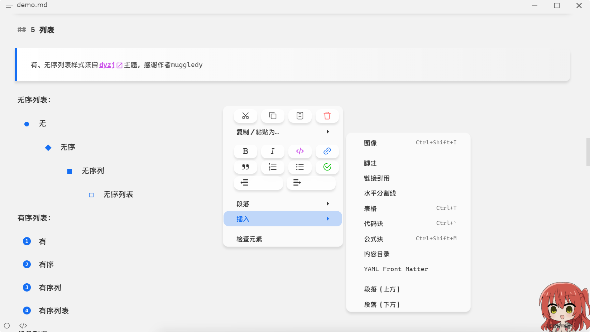</br>
  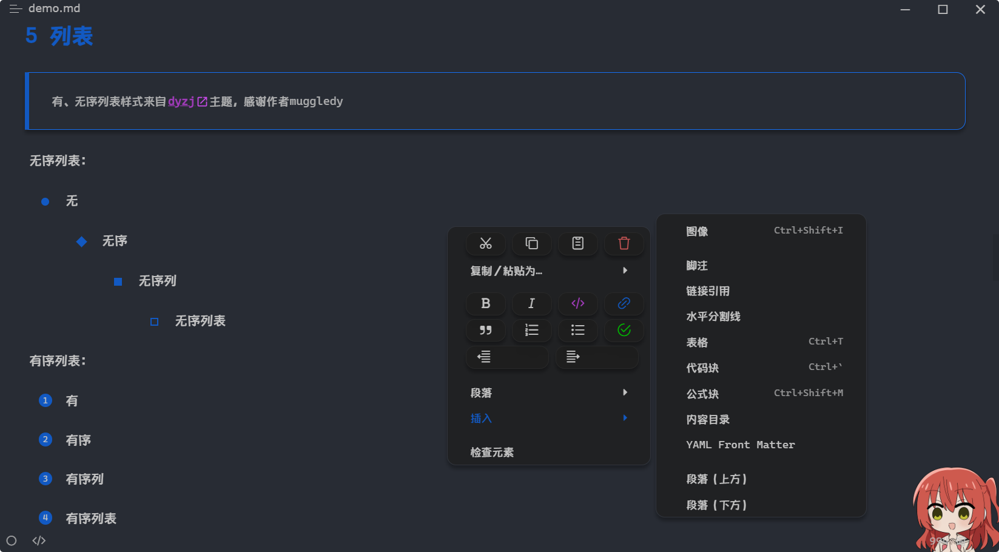</br>
  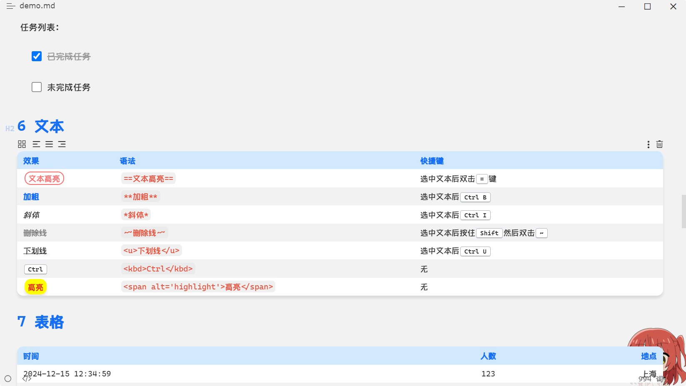</br>
  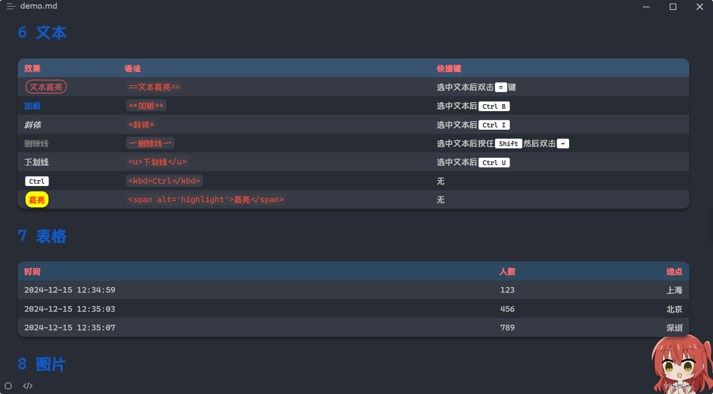</br>
  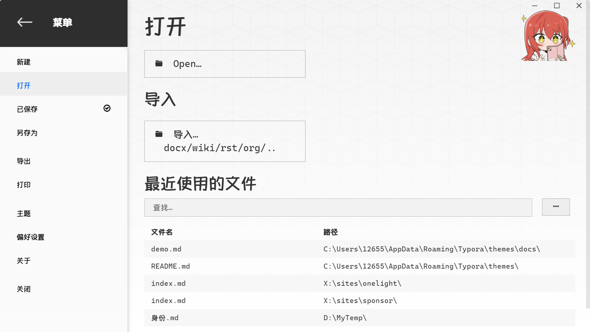</br>
  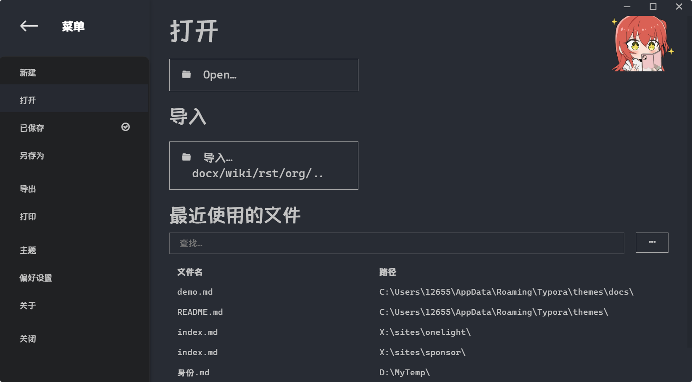</br>
</details>


---

## 2.如何使用

下面两种办法视自己方便程度选一种即可

### 2.1 下载文件（推荐）

> 1. 下载[主题文件压缩包](https://github.com/xtr-hub/typora-onelight-theme/releases)
> 2. 在typora中选择 文件 → 偏好设置 → 外观 → 打开主题文件夹
> 3. 将下载的压缩包解压，将**css文件**和**文件夹**粘贴到typora的主题文件夹themes中
> 4. 重启Typora然后在菜单栏切换主题，大功告成
>
> 这种方法的优点是下载的文件更少，只含有主题必须的文件，缺点是比较麻烦，如果后续想要更新需要重新下载进行替换

### 2.2 克隆

> [!caution]
>
> 1. 同上找到typora的主题文件夹themes，在这个文件夹下打开一个终端
>
> 2. **为了避免克隆到其他分支的无关文件，请一定要使用下面这条命令克隆！！否则你要下载很长时间**（项目fork自官方仓库，提交历史包含了gh-pages分支的记录）
>
>    ```shell
>    git clone --single-branch https://github.com/xtr-hub/typora-onelight-theme.git
>    ```
>
> 这种方法的优点是比较方便，后续更新只需要`git pull`命令即可获取最新的提交，缺点是clone会将整个项目的文件下载下来，包括一些不必要的md文件等

---

## 3.关于自定义

### 3.1 文件夹结构

```
📂 themes                              # Typora 主题根目录
├── 📂 onelight                        # OneLight 主题资源目录
│   ├── 📂 fonts                       # 字体资源目录
│   │   ├── CascadiaCode.woff2        
│   │   └── MiaoZi-GuoZhiTi.woff2     
│   ├── 📂 img                         # 图片资源目录
│   │   ├── bg.gif                     
│   │   ├── ...                                  
│   └── 📂 style                       # 样式文件目录
│       ├── blockquote.css             # 引用块样式
│       ├── code.css                   # 代码块样式
│       ├── editor.css                 # 编辑器样式
│       └── ...
├── onelight-dark.css                  # OneLight 暗色主题样式文件
├── onelight.css                       # OneLight 主题的主样式文件
├── onelight.user.css                  # 用户自定义样式文件（仓库中没有，有需要自己创建，样式优先级高）
└── onelight-dark.user.css             # 同上，但是深色主题自定义样式文件
```

### 3.2 自定义配置

如果你想添加一些自己的样式，不建议你直接修改`onelight.css`文件。

你可以在`onelight.css`同级目录下新建一个`onelight.user.css`文件，将你的样式放在这个文件，它有更高的优先级，而且你后续要更新只需要更新`onelight.css`，不会覆盖你的样式

⚠️暗色主题添加`onelight-dark.user.css`文件

如果`onelight.user.css`无效，你可能要添加`!important`提高优先级

### 3.3 历史风格参考

以下通过注释导入语句切换风格的说明和截图适用于旧版主题。当前版本统一使用 `onelight/style/theme.css`，建议通过 [主题设置页](#8主题设置页与静态部署)调整外观。

> [!important]
>
> **如何切换风格?**
>
> 浅色主题修改`onelight.css`,深色主题修改`onelight-dark.css`
>
> 在文件顶部有类似下面的导入语句，可以选择性**注释**和**取消注释**来修改选择对应的风格
>
> ```css
> // ...exist code
> 
> /* 引用块，警告框样式 依次为 原样式 默认*/
> /* @import './onelight/style/blockquote/blockquote.css'; */
> @import './onelight/style/blockquote/blockquote2.css';
> 
> // ...exist code
> ```
>
> 比如我要切换引用块、警告框样式风格为“原样式”，可以这样改，以此类推，其他风格的选择不再赘述
>
> ```css
> // ...exist code
> 
> /* 引用块，警告框样式 依次为 原样式 默认*/
> @import './onelight/style/blockquote/blockquote.css';
> /* @import './onelight/style/blockquote/blockquote2.css'; */
> 
> // ...exist code
> ```

#### 3.2.1 标题

<div align="center">
  <table>
    <tr>
      <th>默认</th>
      <th>彩色</th>
    </tr>
    <tr>
      <td>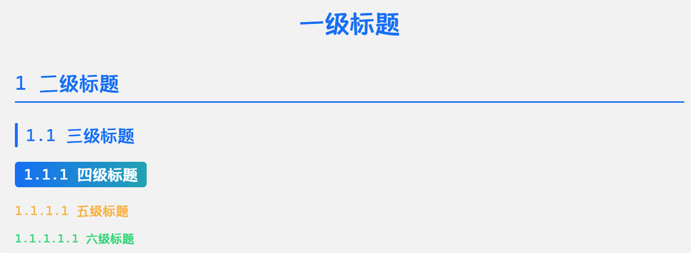</td>
      <td>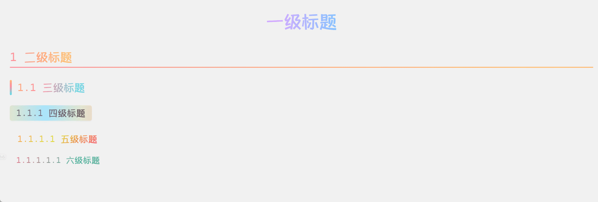</td>
    <tr>
	    <td>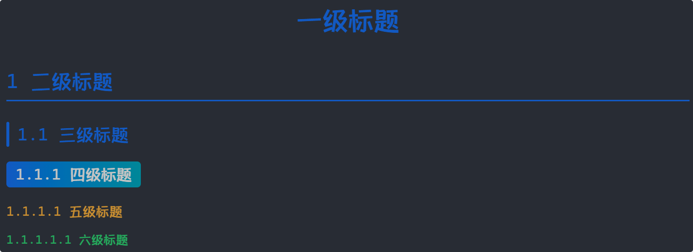</td>
      <td>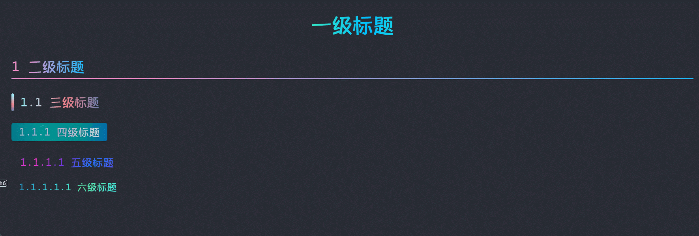</td>
  </table>
</div>

#### 3.2.2 列表

> [!warning]
>
> 默认风格某些情况下会出现[错位](https://github.com/xtr-hub/typora-onelight-theme/issues)（已知问题）

<div align="center">
  <table>
    <tr>
      <th>默认</th>
      <th>普通</th>
    </tr>
    <tr>
      <td>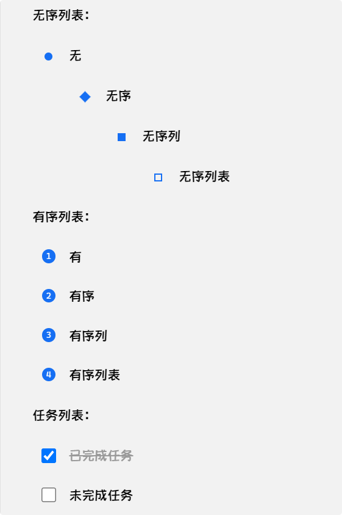</td>
      <td>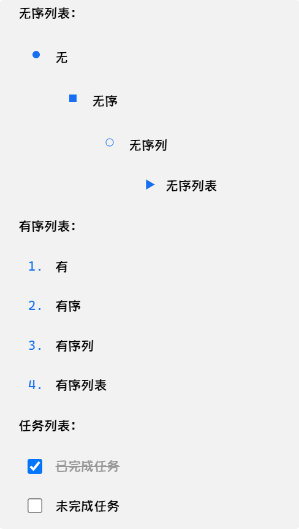</td>
    </tr>
    <tr>
	    <td>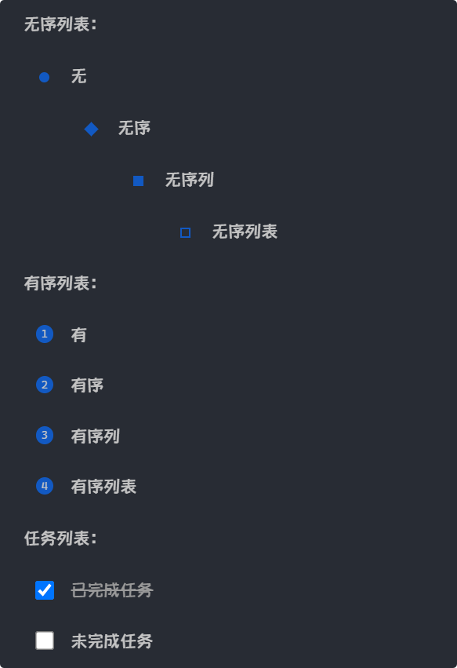</td>
      <td>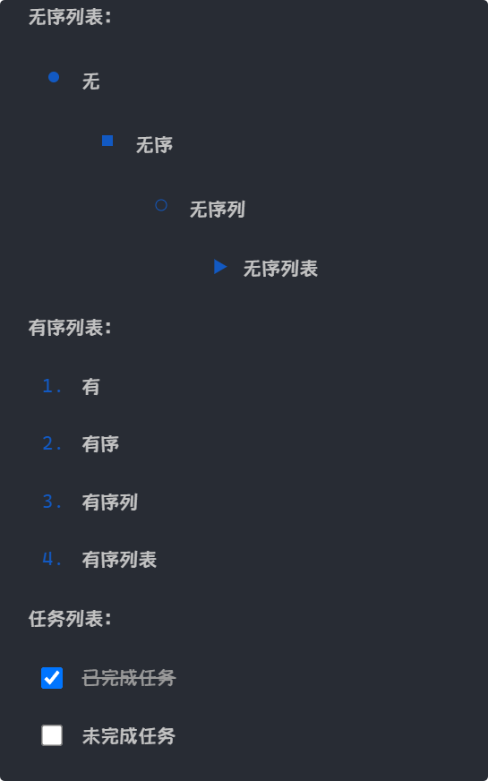</td>
    </tr>
  </table>
</div>

#### 3.2.3 警告框

<div align="center">
  <table>
    <tr>
      <th>默认</th>
      <th>原样式</th>
    </tr>
    <tr>
      <td>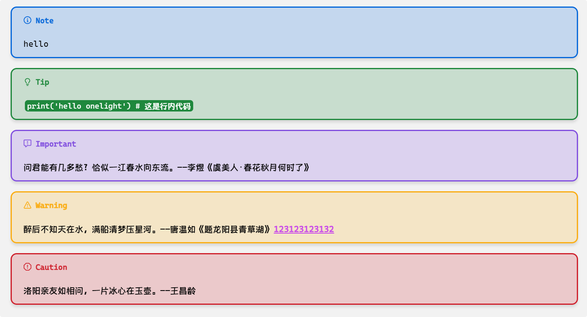</td>
      <td>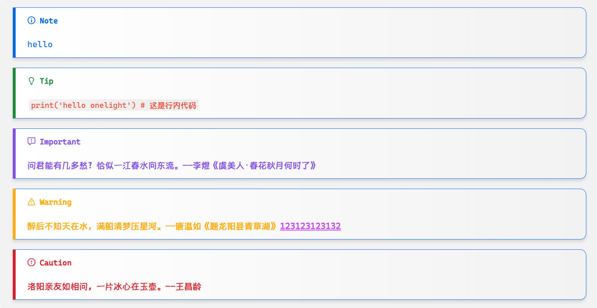</td>
    </tr>
    <tr>
	    <td>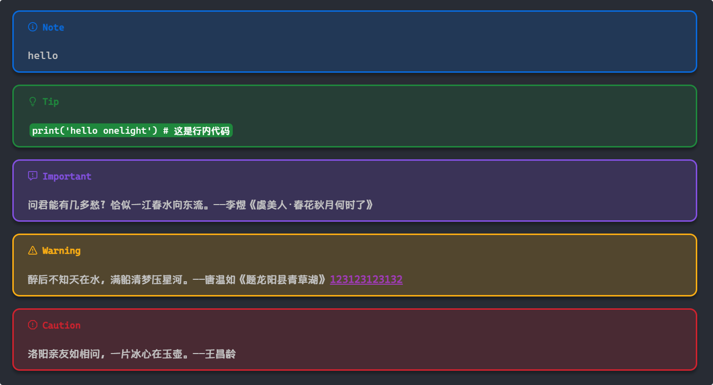</td>
      <td>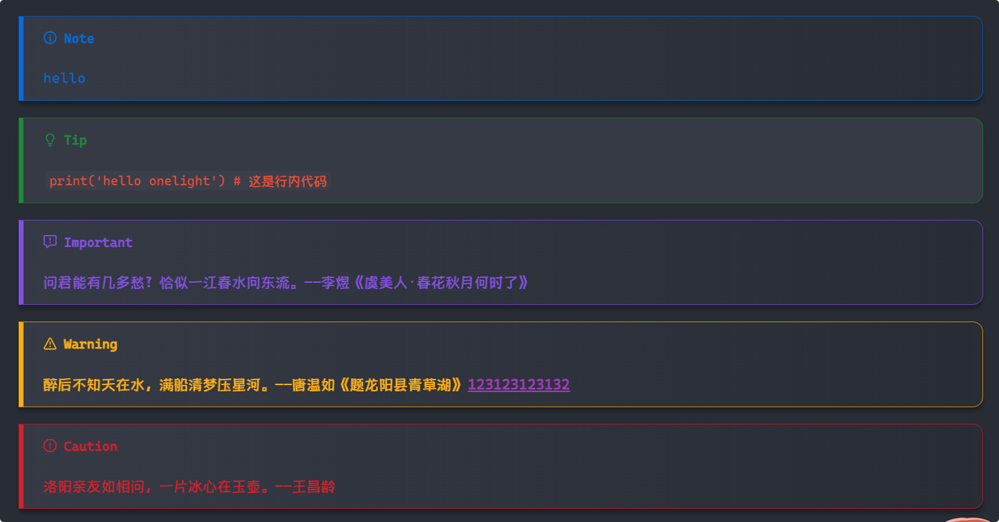</td>
    </tr>
  </table>
</div>

#### 3.2.4 背景

动态星空背景针对暗色主题，在`onelight-dark.user.css`顶部添加:

```css
@import './onelight/style/background/grok.css';
@import './onelight/style/background/grok-gpu.css';
```

<div align="center">
  <table>
    <tr>
      <th>默认</th>
      <th>动态星空</th>
    </tr>
    <tr>
      <td>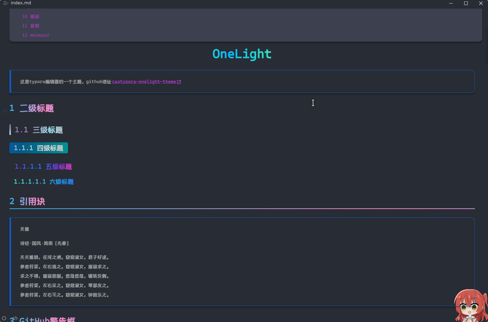</td>
      <td>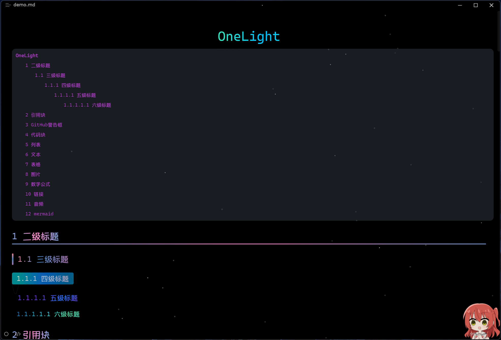</td> 
    </tr>
  </table>
</div>

## 4.关于字体

在`font.css`文件设置了默认字体，可以自行修改，如果需要导入字体文件，可在`font.css`中配置

---

## 5.背景图片

当前版本可以直接在[主题设置页](#8主题设置页与静态部署)选择自定义背景和表情包。以下手动修改 `editor.css` 的说明适用于旧版主题。

> [!important]
>
> 背景图片在`onelight/img`文件夹下，另外仓库`docs/img`路径下也有一些其他图片可以使用，你也可以添加自己的图片（最好使用透明背景的图片），然后在`editor.css`文件中搜索关键字 `背景图片`找到下面代码替换图片名
>
> ```css
> div#megamenu-section-open {
>     // ...
>     background-image: url('../img/mutou.gif');
>     // ...
> }
> 
> content {
>     //...
>     background-image: url('../img/mutou.gif');
>     //...
> }
> ```
>
> 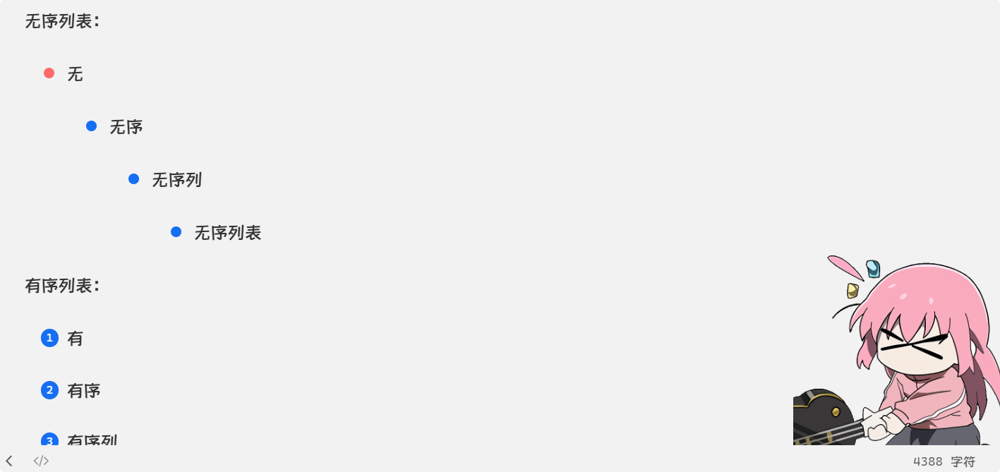

---

## 6.其他

⭐ 如果喜欢主题的话，请给一个star吧，感谢🙏！

✅ 一体化模式下主题效果更佳✨

❓ 有问题可以在 [Issues](https://github.com/xtr-hub/typora-onelight-theme/issues) 提问，欢迎各种意见

📄 [docs](https://github.com/xtr-hub/typora-onelight-theme/tree/onelight/docs)文件夹中有示例文章的markdown文件📄

🖼️ [img](https://github.com/xtr-hub/typora-onelight-theme/tree/onelight/onelight/img)文件夹中有主题的背景图片，如果不需要可以直接删除

---

## 7.演示图片自动采集

仓库提供了一个基于 **Typora 官方 theme toolkit `html-preview`** 的截图工具，用于自动生成浅色/深色主题的预览图片。它直接使用官方预览页，不再自己实现 Markdown 渲染器，也不会控制 Typora 或桌面。

```bash
cd tools/demo-shots
npm install
npm run shots
```

首次运行会自动拉取官方 toolkit。生成结果默认在 `docs/img/preview/`，详细用法和限制见 [tools/demo-shots/README.md](tools/demo-shots/README.md)。

---

## 8.主题设置页与静态部署

可视化设置页支持浅色、深色实时预览，调整强调色、排版和圆角，使用本地图片或链接自定义背景和表情包，并调节它们的位置和尺寸。设置可以导出为 JSON，也可以重新导入。

先安装本仓库版本的主题，然后在仓库根目录启动本地预览：

```bash
node tools/theme-configurator/serve.mjs
```

访问 `http://127.0.0.1:4173/tools/theme-configurator/`。在 Typora 的「偏好设置 → 外观」中打开主题文件夹，在网页中选择该文件夹并保存；也可以下载 CSS 后手动放入。Typora 会加载 `onelight.user.css` 与 `onelight-dark.user.css`，重启或切换主题后生效。直接保存会保留文件中已有的其他自定义 CSS。

网站本身是纯静态的。运行 `node tools/theme-configurator/build.mjs` 后，可将 `dist/theme-configurator/` 整个目录部署到静态托管服务，不需要运行后端。目录直接写入需要支持 File System Access API 的浏览器及 HTTPS 或 localhost；其他环境可以下载 CSS 手动安装。

完整说明见 [tools/theme-configurator/README.md](tools/theme-configurator/README.md)。
