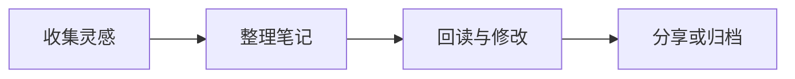

# Paperlight

给想法留一点空白，让记录慢慢成形。

[TOC]

## 从一段文字开始

清晨打开笔记，先写下一件值得记住的小事。也许是读到的一句话，也许是散步时冒出的灵感。**先把想法留下来**，再慢慢整理结构。

一份好读的笔记，既容得下中文的停顿，也照顾 English words 的节奏。用 *斜体* 留下旁注，用 ==高亮== 标记重点，用 `draft.md` 记住文件名；细节各有位置，阅读自然顺畅。

> 写作不必从完整的答案开始。一句清楚的问题，也是一页笔记的好开头。

> [!TIP]
> 试着切换浅色和深色，再调整字号与行高，找到适合长时间阅读的节奏。

## 把灵感变成计划

这周想整理一份「周末阅读札记」，让零散的摘录和自己的想法放在一起。

- 摘录：保存触动自己的句子，并记录出处。
- 思考：写下认同、疑问和还想继续追问的事。
  - 这段话与我最近的经历有什么联系？
  - 下一次阅读时，可以带着什么问题出发？

### 本次整理的三个步骤

1. 把想法写成短句，暂时不修改。
2. 合并相近的内容，为每一组拟一个小标题。
3. 回读全文，删去重复，补上必要的说明。

- [x] 收集本周摘录
- [ ] 补上自己的理解

## 写给明天的代码

笔记里也可以放一小段代码。清楚的命名和恰当的注释，会让未来的自己更快想起当时的思路。

```javascript
// 为今天的阅读留一个位置
const note = {
  title: '周末阅读札记',
  minutes: 25,
  tags: ['阅读', '灵感']
};
console.log(`开始记录：${note.title}`);
```

复制一段文字可以使用 <kbd>Ctrl</kbd> + <kbd>C</kbd>；完成修改后，用 ~~待整理~~ 标记曾经需要处理的内容。

## 回看与整理

表格适合放需要对照的信息。给内容留出合适的宽度，比把每个格子填满更有帮助。

| 内容 | 时间 | 留下什么 |
| :--- | :--- | :--- |
| 阅读摘录 | 周三 · 20 分钟 | 一句值得反复读的话 |
| 散步随记 | 周六 · 15 分钟 | 一个新发现 |
| 每周回顾 | 周日 · 30 分钟 | 下周想继续探索的问题 |

> [!NOTE]
> 喜欢现在的效果后，可以在[在线配置页](https://xtr-hub.github.io/paperlight-typora-theme/)保存配置，再回到 Typora 继续自己的记录。

## 多一点表达方式

### 图片与题注


本地图片和动态 GIF 都可以放进笔记，或用作主题的背景与表情包。

### 公式

把每天的阅读时长记为 $t_i$，一周的累计时间可以写成：

$$
T = \sum_{i=1}^{7} t_i
$$

### 流程图



#### 留一个问题

今天记录的内容里，哪一句值得带到明天？

##### 补充线索

给相关笔记加一个链接，下一次整理时就容易找到。

###### 结束之前

从今天的一小段开始，再读一遍。

---

[返回项目](https://github.com/xtr-hub/paperlight-typora-theme) · [在线调整外观](https://xtr-hub.github.io/paperlight-typora-theme/)
