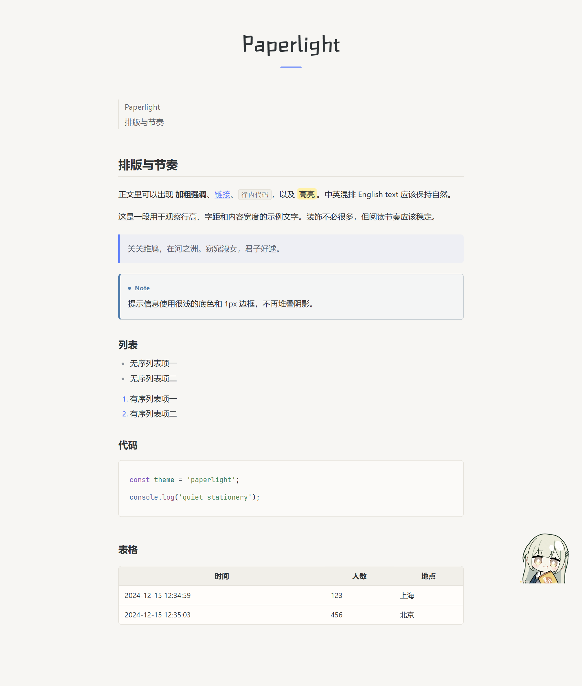
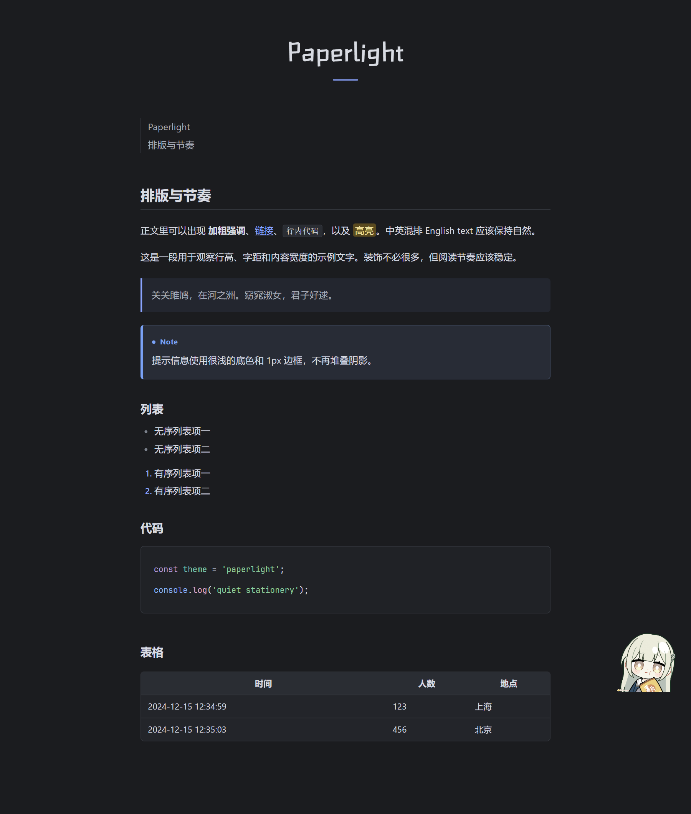

# Paperlight Theme for Typora

Paperlight 提供浅色和深色主题，以及支持实时预览的在线设置页。它基于 [OneLight](https://github.com/caolib/typora-onelight-theme) 演化而来，感谢原作者 @caolib。

以下图片展示浏览器中的示例预览，实际 Typora 窗口可能略有差异。

[查看安装与配置说明](https://github.com/xtr-hub/paperlight-typora-theme#readme) · [打开在线设置页](https://xtr-hub.github.io/paperlight-typora-theme/)
